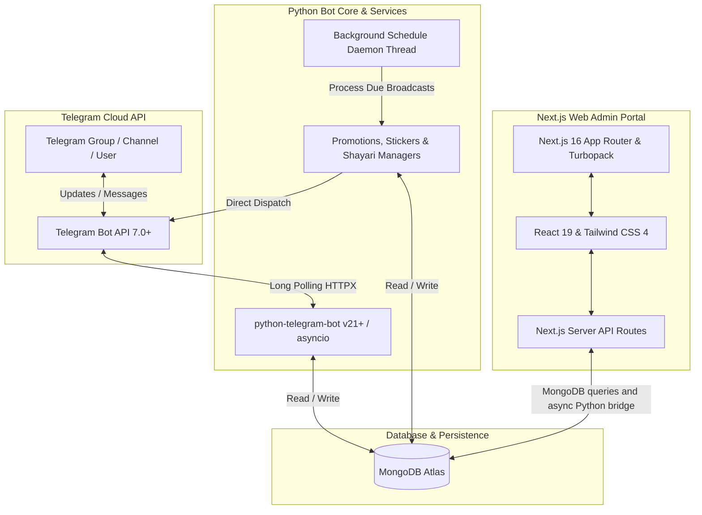
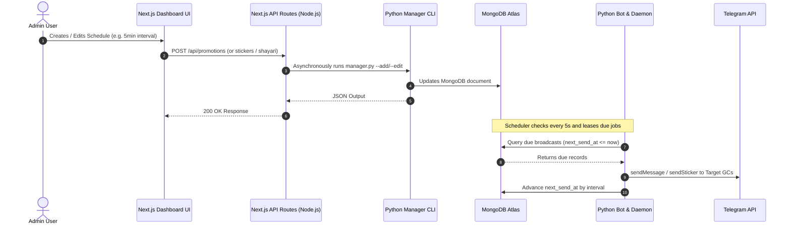

# Waguri – Advanced Multi-Group & Multi-Channel Telegram Management Platform

A high-performance, enterprise-grade Telegram management and moderation platform named **Waguri** (`@Ms_Waguri_bot`) built with Python and `python-telegram-bot` in long polling mode.

Waguri is architected as a **scalable, multi-tenant platform** for Telegram groups, supergroups, and channels, featuring tenant isolation by `chat_id`, role-based access control (RBAC), private owner dashboards, interactive inline settings panels, progressive anti-spam, whitelist-powered anti-link protection, flood control, media filters, anti-forward, anti-bot, emergency raid mode, and MongoDB Atlas persistence with indexed collections.

---

## Architecture & Tenant Isolation


---

## Permission Levels (Role-Based Access Control)

Waguri enforces 3 distinct, server-side verified permission levels:

1. **Group Owner (`status == OWNER`):**
   - Full control over all moderation features, spam thresholds, punishment durations, warning messages, and group reset.
   - Authority to authorize Waguri group managers and customize protection rules.
2. **Authorized Group Administrators (`status in [ADMINISTRATOR, OWNER]`):**
   - Manage moderation settings via `/settings`, `/enable`, `/disable`.
   - Issue manual moderation penalties: `/mute`, `/unmute`, `/ban`, `/unban`, `/warnings`, `/resetwarnings`.
   - Manage whitelist (`/whitelist`) and blacklist (`/blacklist`).
   - Review moderation audit logs (`/logs`) and live group statistics (`/stats`).
3. **Regular Members:**
   - Strictly forbidden from modifying bot settings, disabling protections, or accessing private audit logs.
   - Any attempt to execute administrative commands is rejected:
     ```text
     You need administrator privileges to use this command.
     ```

---

## Private Owner Dashboard (`/start` in Private)

When someone opens a private chat with `@Ms_Waguri_bot` and sends `/start`, Waguri displays a private dashboard with 8 interactive inline buttons:

```text
👑 Welcome to Waguri Management Platform!

Select an option below to manage your chats or learn more:
[ ➕ Add Waguri to Group ]   [ 📢 Add Waguri to Channel ]
[ 👥 My Groups ]            [ 📢 My Channels ]
[ 📖 Help & Commands ]       [ ℹ️ About Waguri ]
[ 💬 Contact Support ]       [ ⚡ Bot Features ]
```

- **`My Groups` & `My Channels`:** Queries all registered chats and performs server-side verification to display **only** chats where the user holds verified administrative privileges. Selecting any chat displays its live management summary.
- **Group `/start` Preservation:** When `/start` is sent inside a group or channel, Waguri maintains its standard greeting:
  ```text
  Hi, welcome. I am Waguri. How can I help you
  ```

---

## Interactive Group Management Dashboard (`/settings`)

When a verified administrator sends `/settings` in a group, Waguri presents an interactive mobile-optimized inline keyboard:

```text
⚙️ WAGURI GROUP MANAGEMENT
👥 Group: Tech Community
🆔 ID: -1001234567890

Moderation Controls:
[ 🔗 Anti-Link: ON 🟢 ]        [ 🛡️ Anti-Spam: ON 🟢 ]
[ 🌊 Flood: ON 🟢 ]            [ ⚠️ Warnings: ON 🟢 ]
[ ⛔ Auto-Restrict: ON 🟢 ]     [ ⏩ Anti-Forward: OFF 🔴 ]
[ 🚪 Anti-Join Spam: OFF 🔴 ]   [ 🤖 Anti-Bot: OFF 🔴 ]
[ 📸 Media Filter: OFF 🔴 ]    [ 🌐 Link Whitelist ]
[ ⏱ Spam (30s) ]              [ 🔢 Warn Limit (2) ]
[ 📊 Group Statistics ]        [ 📋 Moderation Logs ]
[ 🔄 Refresh ]                 [ ❌ Close ]
```

- **Real-Time Toggles:** Toggles Anti-Link, Anti-Spam, Flood Detection, Warning System, Auto-Restriction, Anti-Forward, Anti-Join Spam, Anti-Bot, and Media Filter.
- **Sub-Menus:**
  - 🌐 **Link Whitelist:** View trusted domains allowed in the group.
  - ⏱ **Spam Window:** Adjust detection window: `15s`, `30s`, `45s`, `60s`, `120s`.
  - 🔢 **Warning Limit:** Adjust warning threshold: `1`, `2`, `3`, `4`, `5`.
  - 📊 **Group Statistics:** View messages checked, links deleted, spam deleted, warnings issued, and restrictions applied.
  - 📋 **Moderation Logs:** Review the latest audit events with timestamps.
  - ❌ **Close:** Closes the dashboard cleanly.
- **Server-Side Verification:** Every callback query re-verifies administrator status before applying changes.

---

## Moderation Systems & Features

### 1. Advanced Anti-Link Protection with Whitelisting
- **Detection Scope:** Standard HTTP/HTTPS URLs, `www.`, bare domains (`example.com`, `site.io`), Telegram links (`t.me/...`), invite links (`t.me/+xxxxx`), deep links (`tg://...`), hidden hyperlinked text (`TEXT_LINK`), and caption links in media.
- **Exemptions:** Group owner and administrators are exempt.
- **Per-Group Link Whitelist:**
  - `/whitelist add <domain>` – Add a trusted domain (e.g. `/whitelist add google.com`).
  - `/whitelist remove <domain>` – Remove a domain.
  - `/whitelist list` – View all whitelisted domains.
  - If all detected URLs in a message match whitelisted domains, the message is permitted.
- **Per-Group Content Blacklist:**
  - `/blacklist add <pattern>` – Block specific domains, phishing phrases, or keywords.
  - `/blacklist remove <pattern>` – Remove from blacklist.
  - `/blacklist list` – View blacklisted patterns.

### 2. Advanced Anti-Spam System
- **Comparison Engine:** Normalized whitespace comparison, trimmed edges, case-insensitivity, and SHA-256 content fingerprinting.
- **Progressive Punishment Sequence:**

| Message Count | Action Taken | Warning Issued |
|---|---|---|
| **1st message** | Allowed | No warning |
| **2nd identical message** | Deleted | ⚠️ **Warning 1/2** |
| **3rd identical message** | Deleted | ⚠️ **Warning 2/2** |
| **4th identical message** | Deleted + Batch Purge | 🚫 **24-Hour Restriction** |

- **Custom Warnings & Cleanup:** Group administrators can customize warning messages via database settings. Temporary warnings auto-delete after 10 seconds to keep chats clean.
- **Batch Spam Cleanup:** On the 4th violation, all recorded prior messages from the spam incident are automatically purged.
- **Reliable 24-Hour Restriction:** Restricts message permissions for 24 hours while allowing reading. Permissions restore cleanly upon expiration.

### 3. Flood & Burst Message Protection
- Tracks message frequency per `(chat_id, user_id)`.
- Default: `FLOOD_WINDOW_SECONDS = 10`, `FLOOD_MESSAGE_LIMIT = 8`.
- Logs alerts and provides group owners configurable burst controls.

### 4. Additional Protection Modules
- **Anti-Forward:** Detects and deletes forwarded channel/group messages from regular members when enabled.
- **Anti-Bot Protection:** Detects unauthorized bots added by regular members, removes them, and alerts group administrators.
- **Anti-Join Spam:** Monitors join bursts (e.g., $\ge 5$ joins in 10s) and alerts administrators.
- **Media Restrictions:** Per-group toggle for photos, videos, documents, stickers, GIFs/animations, voice notes, and video notes.
- **Emergency Raid Mode:** `/raid on` enables high-alert lockdown mode; `/raid off` restores normal moderation.

### 5. Advanced Abuse Detection & Auto-Moderation System ("Abuse")

Waguri includes an advanced, multi-layer **Abuse Detection & Auto-Moderation System** specifically engineered to detect, remove, and penalize inappropriate messages, threats, sexual harassment, and deliberate filter bypasses in real-time.

#### Detection Coverage:
- **Sexual Abuse & Assault Terms:** Non-consensual sexual references, assault threats, coercion, and degradation.
- **Sexual Harassment:** Unsolicited requests ("send nudes", "show boobs"), predatory propositions, and objectification.
- **Sexual Vulgarity:** Vulgar sexual anatomy and acts across English, Hindi, and Hinglish.
- **Physical Assault & Violent Threats:** Death threats ("kill yourself", "i will kill you", "jaan se marunga"), acid threats, stabbing, and severe bodily harm.
- **Molestation & Groping:** Unwanted touch, molestation terms, and eve-teasing terminology.
- **Rape-Related Harassment:** Non-consensual coercion, rape threats, and gang-rape references.
- **Child Sexual Exploitation (CSAM):** Pedophilia and underage exploitation terminology (scored 100 with immediate maximum enforcement).
- **Targeted Personal Insults:** Slurs aimed at individuals, character assassination, and family degradation.
- **Multilingual Support:** English, Roman Hindi (`madarchod`, `bhenchod`, `chutiya`, `randi`), Devanagari Hindi (`मादरचोद`, `बहनचोद`, `चूतिया`), and hybrid Hinglish compounds.

#### Bypass Detection Capabilities:
- **Special Character Insertion:** Detects tokens like `f.u.c.k`, `f*u*c*k`, `f@ck`, `f#ck`, `f!ck`, `f_ck`, `f-ck`.
- **Space Insertion:** Detects spaced-out sequences like `f u c k`, `m a d a r c h o d`, `b h o s d i k e`.
- **Leetspeak & Symbol Substitution:** Translates `@` $\to$ `a`, `4` $\to$ `a`, `3` $\to$ `e`, `1` $\to$ `i`, `0` $\to$ `o`, `5` $\to$ `s`, `$` $\to$ `s`, `7` $\to$ `t`.
- **Unicode Homoglyphs & Lookalikes:** Converts visually deceptive Cyrillic, Greek, and mathematical lookalikes into Latin characters.
- **Zero-Width & Invisible Characters:** Strips zero-width spaces (`\u200B`), non-joiners (`\u200C`), joiners (`\u200D`), and Zalgo combining marks.
- **Repeated Characters:** Reduces sequences like `fuuuuuck`, `shiiiiit`, `bhosssssdike` to standard base forms.
- **Controlled Fuzzy Matching:** Damerau-Levenshtein distance matching for tokens $\ge 6$ chars (e.g. `chutiyaa` $\to$ `chutiya`, `madarchot` $\to$ `madarchod`) without generating false positives on ordinary words.
- **Context-Aware Exemptions:** Automatically distinguishes legitimate reporting, education, and anti-abuse awareness campaigns while rejecting exemptions when direct second-person attacks are present.

#### Progressive Warning & Mute Sequence:
1. **Violation 1:** Message Deleted + Warning 1/3 (Auto-deletes notice after 10s).
2. **Violation 2:** Message Deleted + Warning 2/3 (Auto-deletes notice after 10s).
3. **Violation 3:** Message Deleted + Warning 3/3 (Auto-deletes notice after 10s).
4. **Violation 4:** Message Deleted + **30-Minute Temporary Mute**.
5. **Violation 5:** Message Deleted + **2-Hour Temporary Mute**.
6. **Violation 6+:** Message Deleted + **24-Hour Temporary Mute**.
- **Auto-Expiry:** Warnings automatically expire after configurable hours (default 24h).
- **Audit Trail:** Every moderation event is recorded in MongoDB (`chat_moderation_logs`).

#### Administrator Commands (`/abuse`):
- `/abuse on` – Enable Abuse detection in current group.
- `/abuse off` – Disable Abuse detection.
- `/abuse status` – Display status, thresholds, and statistics.
- `/abuse words` – List custom blocked and whitelisted keywords.
- `/abuse addword <word>` – Add custom blocked keyword.
- `/abuse removeword <word>` – Remove custom keyword.
- `/abuse warnings [@user|id]` – Check active abuse warnings for a member.
- `/abuse reset [@user|id]` – Reset warnings for a member.
- `/abuse settings` – View sensitivity, warning limits, and mute duration.
- `/abuse logs` – View recent Abuse moderation audit logs.

---

## Bot Commands & Help (`/help`)

When `/help` is sent in any chat or accessed via `📖 Help & Commands` in the private dashboard, Waguri displays the complete command menu and feature reference directly in the chat:

```text
🤖 Waguri Bot Commands & Help

General Commands:
• /start - Start Waguri
• /help - View this help menu
• /about - About Waguri
• /contact - Contact support (@lucky_paji)

🛡️ Group Management Commands:
• /settings - Interactive moderation configuration dashboard
• /features - View status of all features in current group
• /enable <feature> - Enable a moderation feature
• /disable <feature> - Disable a moderation feature
• /stats - View moderation statistics for this chat
• /logs - Review recent moderation audit logs
• /id - View chat and user IDs

⚡️ Moderation & Penalties:
• /whitelist [add|remove|list] <domain> - Manage allowed domains
• /blacklist [add|remove|list] <pattern> - Manage blocked patterns
• /warnings [reply|id] - View member warnings
• /resetwarnings [reply|id] - Clear user warnings
• /mute [reply|id] [time] - Mute user (e.g. 10m, 2h, 1d)
• /unmute [reply|id] - Restore member messaging permissions
• /ban [reply|id] - Ban member from group
• /unban [reply|id] - Unban member
• /antlink [on|off] - Toggle anti-link protection
• /antibiolink [on|off] - Toggle bio link protection
• /cleanservice [on|off] - Clean service messages (joins, leaves, pins)
• /antispam [on|off] - Toggle repeated-message spam detection
• /abuse [on|off|status|words|addword|removeword|warnings|reset|settings|logs] - Advanced Abuse Detection & Auto-Moderation System

🛡️ Group Chat (GC) Messaging Controls (Admin Only):

```

---

## Command Reference

### User & General Commands (BotCommandScopeAllPrivateChats)
- /start – Open private dashboard with interactive navigation.
- /help – Interactive clickable command launcher and documentation.
- /about – Information about Waguri's architecture.
- /contact – Directs users to bot administrator @lucky_paji.

### Group Management & GC Messaging (`BotCommandScopeAllChatAdministrators`)
- `/settings` – Open the interactive inline management dashboard.
- `/features` – View statuses of all moderation features for the current chat.
- `/stats` – View isolated moderation statistics for the current chat.
- `/logs` – Review recent moderation audit actions.
- `/id` – Inspect chat ID, sender ID, and replied message/user IDs.
- `/enable <feature>` – Enable a feature (`antilink`, `antispam`, `flood`, `warnings`, `autorestrict`, `antiforward`, `antijoin`, `antibot`, `media`, `raid`).
- `/disable <feature>` – Disable a feature.
- `/whitelist [add|remove|list] <domain>` – Manage link whitelist.
- `/blacklist [add|remove|list] <pattern>` – Manage content blacklist.
- `/warnings [reply|user_id]` – View member warnings and restriction history.
- `/resetwarnings [reply|user_id]` – Clear all warnings for a member.
- `/mute [reply|user_id] [duration]` – Temporarily mute a user (e.g. `/mute 10m`, `/mute 2h`, `/mute 1d`).
- `/unmute [reply|user_id]` – Remove restrictions and unmute member.
- `/ban [reply|user_id]` – Ban a user from the group.
- `/unban <user_id>` – Unban a previously banned user.
- `/raid [on|off]` – Toggle emergency raid lockdown mode.

### Super-Admin Bot Owner Controls
Accessible only to Telegram User IDs configured in `BOT_OWNER_IDS`:
- `/owner` – View platform scale, active chats, uptime, database health, and activity metrics.
- `/owner broadcast <message>` – Send a rate-limited announcement across all registered chats.
- `/owner emergency <feature> [on|off]` – Apply a global emergency feature override without mutating individual group settings.

---

## Multi-Tenant Database Architecture (MongoDB Atlas)

Waguri stores data in MongoDB collections and creates indexes for chat, user, timestamp, and scheduling lookups:

1. **`chats`**: Registered groups and channels with titles, types, active statuses, and timestamps.
2. **`chat_settings`**: Per-chat toggles (`anti_link_enabled`, `anti_spam_enabled`, `flood_detection_enabled`, `warning_system_enabled`, `auto_restrict_enabled`, `anti_forward_enabled`, `anti_join_spam_enabled`, `anti_bot_enabled`, `media_restrictions_enabled`, `allowed_media_types`, `spam_window_seconds`, `warning_limit`, `restriction_duration_seconds`, `raid_mode_enabled`).
3. **`chat_admins`**: Role-based permissions mapping (owner, admin, manager).
4. **`chat_moderation_logs`**: Timestamped audit trail of all moderation actions.
5. **`chat_warnings`**: Progressive warnings issued to users.
6. **`chat_spam_incidents`**: Rolling spam tracking per `(chat_id, user_id)`.
7. **`chat_spam_messages`**: Recorded spam message IDs for batch purge upon restriction.
8. **`chat_link_whitelist`**: Trusted domains per chat.
9. **`chat_blacklist`**: Blocked patterns and domains per chat.
10. **`chat_statistics`**: Live moderation metrics per chat.
11. **`chat_join_events`**: Member join timestamps for anti-join spam and anti-bot.
12. **`user_restrictions`**: Mute and ban history with previous permissions for clean restoration.
13. **`callback_sessions`**: Ephemeral secure callback data storage.

---

## Project Structure

```text
Waguri/
│
├── config.py                 # Configuration, token validator & owner ID parser
├── database.py               # MongoDB collections, indexes, and multi-tenant data access
├── bot.py                    # Main application runner & polling manager
│
├── handlers/
│   ├── __init__.py           # Pipeline registration across priority groups 0 to 4
│   ├── registration.py       # Bot join/leave lifecycle tracking (ChatMemberHandler)
│   ├── private_dashboard.py  # Private owner dashboard with 9 inline buttons
│   ├── settings_panel.py     # Interactive /settings dashboard & callback router
│   ├── feature_commands.py   # /features, /enable, /disable, /stats
│   ├── admin_check.py        # RBAC verification, permission check & admin TTL cache
│   ├── admin_commands.py     # /antlink, /antispam, /mute, /unmute, /ban, /unban, /warnings, /logs, /id
│   ├── anti_link.py          # Anti-link filter, whitelist & blacklist (/whitelist, /blacklist)
│   ├── anti_spam.py          # Progressive anti-spam, 24h restrictions & batch cleanup
│   ├── media_protection.py   # Media filters (photos, videos, documents, stickers, voice)
│   ├── extra_protection.py   # Anti-forward, anti-bot, anti-join spam, /raid command
│   ├── bot_owner.py          # Super-admin dashboard (/owner, broadcast, emergency)
│   ├── commands.py           # Commands (/start, /help, /about, /contact)
│   ├── command_menu.py       # BotCommandMenu setup for Default & Admin scopes
│   ├── greetings.py          # Greetings ("hii", "hlw", "hello")
│   └── error_handler.py      # Global exception logger
│
├── .env                      # Bot credentials & super-owner IDs (git-ignored)
├── .env.example              # Environment template
├── .gitignore                # Protects secrets, databases, and caches
├── requirements.txt          # Python dependencies
└── README.md                 # Complete documentation
```

---

## Installation & Setup

1. **Install dependencies:**
   ```bash
   pip install -r requirements.txt
   ```

2. **Configure `.env`:**
   ```env
   TELEGRAM_BOT_TOKEN=your_telegram_bot_token_here
   BOT_OWNER_IDS=your_telegram_user_id
   ```

3. **Run the bot:**
   ```powershell
   python bot.py
   ```

4. **Configure the frontend:** Set `MONGODB_URI`, `MONGODB_DB_NAME`, `JWT_SECRET` (at least 32 random bytes), `ADMIN_EMAIL`, and either `ADMIN_PASSWORD` or a valid `ADMIN_PASSWORD_HASH` in `frontend/.env.local`. No default signing key or administrator password is provided.

> [!IMPORTANT]
> **Telegram BotFather & Business Mode Settings:**
> 1. Message [@BotFather](https://t.me/BotFather) on Telegram.
> 2. Send `/setprivacy` $\rightarrow$ select `@Ms_Waguri_bot` $\rightarrow$ choose **Disable** (enables message monitoring in groups).
> 3. For Telegram Business: In Telegram Settings $\rightarrow$ Telegram Business $\rightarrow$ Chatbots, connect `@Ms_Waguri_bot` and enable "Reply to messages".
> 4. Waguri must be granted **Delete Messages** and **Ban Users / Restrict Members** administrator permissions in groups.

---

# Technology Stack and Architecture


This document provides a comprehensive overview of all technologies, frameworks, libraries, protocols, database systems, and architectural patterns utilized in the development and operation of the **Waguri Telegram Management Bot** and its accompanying **Web Administration Dashboard**.

---

## 1. High-Level Architecture Overview

The system is built as a dual-layer, high-performance platform:
1. **Bot Engine Layer (Python)**: An asynchronous, event-driven Telegram bot handling high-throughput real-time message moderation, automated scheduling, and community management.
2. **Dashboard Layer (Next.js & TypeScript)**: A modern, real-time web administration portal providing complete administrative controls over scheduled promotions, stickers, shayari broadcasts, group settings, analytics, and user telemetry.



---

## 2. Core Programming Languages & Runtimes

| Technology | Version / Specification | Role in System |
| :--- | :--- | :--- |
| **Python** | `3.10+` / `3.11` / `3.12` | Powers the core Telegram bot, handler pipelines, moderation filters, daemon scheduler, and CLI data managers. |
| **Node.js** | `18+` / `20+` (LTS) | JavaScript runtime hosting the Next.js server, API routing, and build environment. |
| **TypeScript** | `^5.0.0` | Provides strict static type safety across the entire administrative frontend, UI state, and API payload definitions. |

---

## 3. Telegram Bot Engine & Ecosystem

| Component | Library / Protocol | Purpose & Implementation Details |
| :--- | :--- | :--- |
| **Bot Framework** | `python-telegram-bot` (`>=21.0`) | Fully asynchronous Telegram bot library utilizing Python `asyncio`. Manages `ApplicationBuilder`, update routers, command handlers, and error boundaries. |
| **Telegram Bot API** | API `7.0+` | Implements group moderation (`banChatMember`, `restrictChatMember`, `deleteMessage`), message delivery (`sendMessage`, `sendSticker`), and interactive UI (`InlineKeyboardMarkup`, `InlineKeyboardButton`). |
| **HTTP Transport** | `HTTPX` via `HTTPXRequest` | High-performance asynchronous HTTP client handling Telegram connection pooling, proxy integration (`TELEGRAM_PROXY_URL`), configurable read/write timeouts, and exponential backoff retry policies. |
| **Concurrency Model** | Python `asyncio` + `threading.Thread` | Non-blocking asynchronous event loop for Telegram updates plus a shared scheduler loop that checks due work every 5 seconds. MongoDB leases prevent parallel workers from dispatching the same scheduled item concurrently. |

---

## 4. Frontend Web Administration Dashboard

| Layer | Technology | Details |
| :--- | :--- | :--- |
| **Framework** | **Next.js 16.4.6** | Modern React full-stack framework utilizing the **App Router** (`src/app/`) for unified server-side rendering, client interactive pages, and backend API routes. |
| **UI Library** | **React 19.3.0** & **React DOM 19.3.0** | Component-driven declarative UI utilizing modern hooks (`useState`, `useEffect`, `useMemo`, `useCallback`, `useRef`). |
| **Styling Engine** | **Tailwind CSS 4.3.3** | High-performance utility-first styling with dark-mode color palettes, translucent glassmorphism panels, responsive layout grids, and modern UI transitions. |
| **Bundler & Build Tool** | **Turbopack** (`@tailwindcss/turbopack`) | High-speed, Rust-powered bundler providing instantaneous Hot Module Replacement (HMR) and optimized production builds. |
| **Iconography** | **Lucide React** (`^1.73.0`) | Clean, accessible vector icons for admin menus, status indicators, schedule clocks, modal buttons, and analytics cards. |

---

## 5. Database Systems & Data Persistence

### Primary Storage (MongoDB Atlas)
- **Driver**: PyMongo for the bot and managers; the MongoDB Node.js driver for dashboard authentication, analytics, and user data.
- **Collections**: Chats, per-chat settings, moderation logs and statistics, restrictions, business connections, reply settings and logs, and scheduled promotions, stickers, and shayari.
- **Concurrency**: Unique indexes protect tenant and sender identities. Atomic conditional updates claim cooldown replies and scheduled jobs.
- **Server requirement**: MongoDB 5.2 or newer for the dashboard's bounded `$topN` activity aggregations.
- **PostgreSQL**: A helper module and optional package remain in the repository, but the dashboard currently reads and writes its active data through MongoDB.

---

## 6. Background Scheduling & Dispatch Engine

| Capability | Technical Mechanism |
| :--- | :--- |
| **Worker Execution** | The bot starts the shared scheduler loop; `scheduler_daemon.py` exposes the same loop for standalone use. MongoDB leases prevent multiple workers from concurrently claiming the same scheduled item. |
| **Interval Parser & Strict Time Gap** | Supports intervals such as `3min`, `5min`, `10min`, `15min`, `30min`, `1 hr`, `2h`, `4h`, `6h`, `12h`, `daily`, and `weekly`. |
| **Dynamic Sticker Pack Rotation** | Connects to Telegram `getStickerSet` to query all stickers in a set; cycles sequentially (`(index + 1) % total`) so every interval sends a different sticker from the pack. |
| **Time Drift Protection** | Computes `compute_next_datetime()` advancing in a `while next_dt <= now` loop to prevent back-to-back duplicate firings if the bot was offline. |
| **Chat Routing** | Evaluates `target_type`: targets a `single` chat, `selected` list of chats, or dynamically queries active groups with `all_gc`. |
| **Frontend Isolation** | All scheduling configurations, edits, and intervals are managed **exclusively through the Next.js web frontend** with zero commands or keyboards exposed in Telegram chats. |

---

## 7. Security, Moderation & Moderation Algorithms

| **Security, Moderation & Moderation Algorithms** | Mechanism & Algorithm |
| :--- | :--- |
| **Role-Based Access Control (RBAC)** | Dynamic privilege validation querying Telegram chat member status (`is_sender_admin_or_owner`, `is_bot_owner`, `is_group_owner`). |
| **Command Scope Segregation** | Scoped bot menus via `BotCommandScopeAllPrivateChats` (private commands), `BotCommandScopeAllGroupChats` (member-safe commands), and `BotCommandScopeAllChatAdministrators` (moderation & management controls)). |
| **Anti-Spam & Flood Control** | Token-bucket sliding window frequency counter; message fingerprinting via normalized SHA-256 / hash comparisons to detect copy-paste floods. |
| **Anti-Link Filtering** | Regex pattern matching for standard URLs, Telegram invite links (`t.me/+`, `telegram.me`), and usernames against per-group domain whitelists and blacklists. |
| **Service Message Cleaner** | Automatic detection and deletion of system service messages (`new_chat_members`, `left_chat_member`, `pinned_message`). |
| **Emergency Raid Mode** | Automated rate-limiting of join events within rolling time windows; temporary mass-restricting of incoming accounts during bot raids. |
| **Abuse Detection & Auto-Moderation Engine** | Multi-layer NLP & normalization pipeline (`moderation.abuse`): Unicode NFKC canonicalization, zero-width stripping, Cyrillic/Greek homoglyph substitution, repeated character reduction, leetspeak conversion, space & punctuation intra-word collapse, and Devanagari transliteration. Features 12 categorized dictionaries (sexual abuse, harassment, vulgarity, assault, rape, CSAM, Hindi, Hinglish, threats, insults), compiled regex phrase detectors, controlled Damerau-Levenshtein fuzzy matching ($\ge 6$ chars), context-aware safe-educational exemptions, and escalating 30m/2h/24h temporary mutes with auto-expiring warnings. |

---

## 8. Inter-Process Communication & Architecture Bridge



- **API Route Handlers**: Next.js routes use asynchronous MongoDB queries and run Python management scripts through bounded asynchronous child processes.
- **Cross-Platform Compatibility**: Fully compatible with both Windows (PowerShell/CMD) and Linux (Bash/Docker/systemd).

---

## 9. Development, Quality Assurance & Tooling

- **Version Control**: Git for distributed branch management and atomic commits.
- **Linting & Code Quality**:
  - `eslint` (v9) with `eslint-config-next` for frontend JavaScript/TypeScript validation.
  - Flake8 / PEP 8 standards for Python codebase.
- **Environment Management**:
  - `python-dotenv` for loading `TELEGRAM_BOT_TOKEN`, `BOT_OWNER_IDS`, and MongoDB configuration.
  - Next.js environment resolution for MongoDB, admin credentials, and the required `JWT_SECRET`.
- **Static Analysis**: TypeScript Compiler (`tsc --noEmit`) integrated into build verification pipeline.

---

## 10. Summary Table

| Category | Primary Technologies Used |
| :--- | :--- |
| **Backend & Bot Core** | Python 3.10+, `python-telegram-bot` 21+, `HTTPX`, `asyncio`, `threading` |
| **Frontend Framework** | Next.js 16.4 (App Router), React 19.3, TypeScript 5 |
| **Styling & Assets** | Tailwind CSS 4.3, Turbopack, Lucide React Icons |
| **Database** | MongoDB Atlas (`pymongo`, MongoDB Node.js driver) |
| **Communication Protocols** | Telegram Bot API 7.0 (Long Polling, HTTP/2, REST), JSON IPC |
| **Security & Access** | Role-Based Access Control (RBAC), Regex Domain Filters, Message Fingerprinting |
| **Configuration** | `python-dotenv`, `.env`, Next.js runtime environment variables |


---

# Frontend Dashboard

The admin dashboard is a Next.js application in `frontend/`. From that directory, install the locked dependencies with `npm ci`, then use:

```powershell
npm run dev
npm run lint
npm run build
npm start
```

Configure MongoDB and admin authentication variables in `frontend/.env.local` before starting the dashboard.
