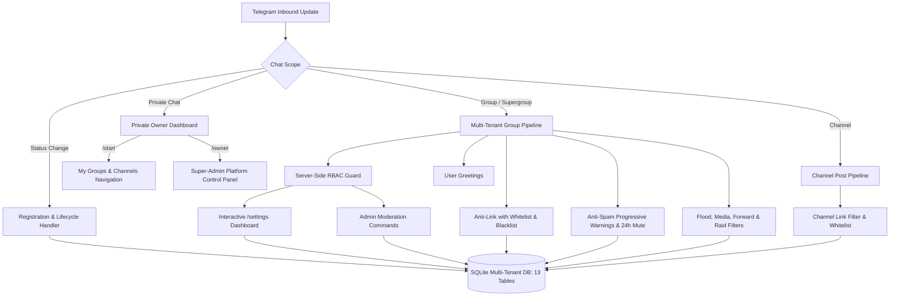

# Waguri – Advanced Multi-Group & Multi-Channel Telegram Management Platform

A high-performance, enterprise-grade Telegram management and moderation platform named **Waguri** (`@Ms_Waguri_bot`) built with Python and `python-telegram-bot` in long polling mode.

Waguri is architected as a **scalable, multi-tenant platform** for unlimited Telegram groups, supergroups, and channels, featuring complete tenant isolation by `chat_id`, role-based access control (RBAC), private owner dashboards, interactive inline settings panels, progressive anti-spam, whitelist-powered anti-link protection, flood control, media filters, anti-forward, anti-bot, emergency raid mode, and SQLite database persistence with 18 dedicated tables and zero-downtime migrations.

Additionally, Waguri includes a complete **Multi-User Personal Auto-Reply System using Telegram Business Secretary Mode**, enabling every user to connect their personal Telegram Business account, customize their auto-reply message, and automatically respond only to first-time incoming senders with guaranteed isolation and zero duplicate messages.

---

## Architecture & Tenant Isolation



---

## Permission Levels (Role-Based Access Control)

Waguri enforces 3 distinct, server-side verified permission levels:

1. **Group Owner (`status == OWNER`):**
   - Full control over all moderation features, spam thresholds, punishment durations, warning messages, and group reset.
   - Authority to authorize Waguri group managers and customize protection rules.
2. **Authorized Group Administrators (`status in [ADMINISTRATOR, OWNER]`):**
   - Manage moderation settings via `/settings`, `/enable`, `/disable`.
   - Issue manual moderation penalties: `/mute`, `/unmute`, `/ban`, `/unban`, `/warnings`, `/resetwarnings`.
   - Manage whitelist (`/whitelist`) and blacklist (`/blacklist`).
   - Review moderation audit logs (`/logs`) and live group statistics (`/stats`).
3. **Regular Members:**
   - Strictly forbidden from modifying bot settings, disabling protections, or accessing private audit logs.
   - Any attempt to execute administrative commands is rejected:
     ```text
     You need administrator privileges to use this command.
     ```

---

## Private Owner Dashboard (`/start` in Private)

When someone opens a private chat with `@Ms_Waguri_bot` and sends `/start`, Waguri displays a private dashboard with 8 interactive inline buttons:

```text
👑 Welcome to Waguri Management Platform!

Select an option below to manage your chats or learn more:
[ ➕ Add Waguri to Group ]   [ 📢 Add Waguri to Channel ]
[ 👥 My Groups ]            [ 📢 My Channels ]
[ 📖 Help & Commands ]       [ ℹ️ About Waguri ]
[ 💬 Contact Support ]       [ ⚡ Bot Features ]
```

- **`My Groups` & `My Channels`:** Queries all registered chats and performs server-side verification to display **only** chats where the user holds verified administrative privileges. Selecting any chat displays its live management summary.
- **Group `/start` Preservation:** When `/start` is sent inside a group or channel, Waguri maintains its standard greeting:
  ```text
  Hi, welcome. I am Waguri. How can I help you
  ```

---

## Multi-User Personal Auto-Reply System (Telegram Business Secretary Mode)

Waguri includes an official Telegram Business Secretary Mode integration. Every person using the bot can connect their personal Telegram account and establish automated, customized replies to clients and incoming contacts.

### Key Capabilities:
- **Complete Multi-User Isolation:** Each user has their own independent settings, custom message templates, first-contact history, and reply logs. User A's configuration never impacts User B.
- **First-Time Sender Detection:** Sends an automatic reply **only** when an external contact messages the connected account for the very first time. Repeat messages from the same sender are suppressed.
- **Two Users Receiving from Same Sender:** If Person C messages User A, Person C receives User A's custom message. If Person C also messages User B, Person C receives User B's custom message.
- **Account Owner Suppression:** When the connected business account owner types a message to a client, Waguri does not reply to the owner.
- **Bot Suppression:** Waguri ignores messages from other bots.
- **Advanced Concurrency & Race-Condition Prevention:** Powered by a unique SQLite database constraint on `(business_user_id, sender_id)` ensuring that simultaneous messages never result in duplicate replies.
- **Telegram Business Lifecycle Updates:** Handles `business_connection` updates (connected, disabled, revoked permissions), `business_message` updates, `edited_business_message`, and `deleted_business_messages`.
- **Permission Checking:** Verifies connection status and `can_reply` rights before attempting to send messages.

### User Dashboard & Commands:
- `/personal` - Open interactive personal auto-reply dashboard with inline controls.
- `/autoreply_on` - Enable personal auto-reply.
- `/autoreply_off` - Disable personal auto-reply.
- `/setmessage <text>` - Set a custom auto-reply message (or enter interactive typing mode in PM).
- `/preview` - Preview the rendered reply message with sample data.
- `/mystatus` - View connection health, permissions, auto-reply mode, and delivery statistics.
- `/resetmessage` - Reset the auto-reply back to the standard default message.
- `/exclude_user <id|@username>` - Exclude a user or chat from receiving auto-replies.
- `/include_user <id|@username>` - Remove an exclusion.

### Dynamic Message Variables:
Templates support dynamic metadata placeholders:
- `{first_name}` - Client's first name
- `{last_name}` - Client's last name
- `{full_name}` - Client's full name
- `{username}` - Client's @username (or name)
- `{time}` - Time of message (HH:MM UTC)
- `{date}` - Date of message (YYYY-MM-DD)

### Advanced Settings:
- **First-Time Sender Only (Default ON):** Responds strictly once to each new client.
- **Cooldown Mode:** When first-time-only is toggled off, applies a configurable cooldown (1h, 6h, 12h, 24h, 48h) between replies to the same sender.
- **Per-User Daily Reply Limits:** Protects accounts by enforcing daily caps (25, 50, 100, 250, 500 replies/day).
- **Reply Delay Configuration:** Configurable delay (0s to 15s) before dispatching auto-replies.
- **Exclusion List:** Blacklist specific users or usernames from ever receiving auto-replies.

### How to Connect (Telegram Business):
1. Open **Telegram Settings** on your phone or desktop.
2. Go to **Telegram Business** $\rightarrow$ **Chatbots** (or **Business Bots**).
3. Search for and select `@Ms_Waguri_bot`.
4. Ensure **"Reply to messages"** is granted.
5. Tap **Save / Done**. Waguri will automatically detect the connection and send a welcome confirmation in private chat!

---

## Interactive Group Management Dashboard (`/settings`)

When a verified administrator sends `/settings` in a group, Waguri presents an interactive mobile-optimized inline keyboard:

```text
⚙️ WAGURI GROUP MANAGEMENT
👥 Group: Tech Community
🆔 ID: -1001234567890

Moderation Controls:
[ 🔗 Anti-Link: ON 🟢 ]        [ 🛡️ Anti-Spam: ON 🟢 ]
[ 🌊 Flood: ON 🟢 ]            [ ⚠️ Warnings: ON 🟢 ]
[ ⛔ Auto-Restrict: ON 🟢 ]     [ ⏩ Anti-Forward: OFF 🔴 ]
[ 🚪 Anti-Join Spam: OFF 🔴 ]   [ 🤖 Anti-Bot: OFF 🔴 ]
[ 📸 Media Filter: OFF 🔴 ]    [ 🌐 Link Whitelist ]
[ ⏱ Spam (30s) ]              [ 🔢 Warn Limit (2) ]
[ 📊 Group Statistics ]        [ 📋 Moderation Logs ]
[ 🔄 Refresh ]                 [ ❌ Close ]
```

- **Real-Time Toggles:** Toggles Anti-Link, Anti-Spam, Flood Detection, Warning System, Auto-Restriction, Anti-Forward, Anti-Join Spam, Anti-Bot, and Media Filter.
- **Sub-Menus:**
  - 🌐 **Link Whitelist:** View trusted domains allowed in the group.
  - ⏱ **Spam Window:** Adjust detection window: `15s`, `30s`, `45s`, `60s`, `120s`.
  - 🔢 **Warning Limit:** Adjust warning threshold: `1`, `2`, `3`, `4`, `5`.
  - 📊 **Group Statistics:** View messages checked, links deleted, spam deleted, warnings issued, and restrictions applied.
  - 📋 **Moderation Logs:** Review the latest audit events with timestamps.
  - ❌ **Close:** Closes the dashboard cleanly.
- **Server-Side Verification:** Every callback query re-verifies administrator status before applying changes.

---

## Moderation Systems & Features

### 1. Advanced Anti-Link Protection with Whitelisting
- **Detection Scope:** Standard HTTP/HTTPS URLs, `www.`, bare domains (`example.com`, `site.io`), Telegram links (`t.me/...`), invite links (`t.me/+xxxxx`), deep links (`tg://...`), hidden hyperlinked text (`TEXT_LINK`), and caption links in media.
- **Exemptions:** Group owner and administrators are exempt.
- **Per-Group Link Whitelist:**
  - `/whitelist add <domain>` – Add a trusted domain (e.g. `/whitelist add google.com`).
  - `/whitelist remove <domain>` – Remove a domain.
  - `/whitelist list` – View all whitelisted domains.
  - If all detected URLs in a message match whitelisted domains, the message is permitted.
- **Per-Group Content Blacklist:**
  - `/blacklist add <pattern>` – Block specific domains, phishing phrases, or keywords.
  - `/blacklist remove <pattern>` – Remove from blacklist.
  - `/blacklist list` – View blacklisted patterns.

### 2. Advanced Anti-Spam System
- **Comparison Engine:** Normalized whitespace comparison, trimmed edges, case-insensitivity, and SHA-256 content fingerprinting.
- **Progressive Punishment Sequence:**

| Message Count | Action Taken | Warning Issued |
|---|---|---|
| **1st message** | Allowed | No warning |
| **2nd identical message** | Deleted | ⚠️ **Warning 1/2** |
| **3rd identical message** | Deleted | ⚠️ **Warning 2/2** |
| **4th identical message** | Deleted + Batch Purge | 🚫 **24-Hour Restriction** |

- **Custom Warnings & Cleanup:** Group administrators can customize warning messages via database settings. Temporary warnings auto-delete after 10 seconds to keep chats clean.
- **Batch Spam Cleanup:** On the 4th violation, all recorded prior messages from the spam incident are automatically purged.
- **Reliable 24-Hour Restriction:** Restricts message permissions for 24 hours while allowing reading. Permissions restore cleanly upon expiration.

### 3. Flood & Burst Message Protection
- Tracks message frequency per `(chat_id, user_id)`.
- Default: `FLOOD_WINDOW_SECONDS = 10`, `FLOOD_MESSAGE_LIMIT = 8`.
- Logs alerts and provides group owners configurable burst controls.

### 4. Additional Protection Modules
- **Anti-Forward:** Detects and deletes forwarded channel/group messages from regular members when enabled.
- **Anti-Bot Protection:** Detects unauthorized bots added by regular members, removes them, and alerts group administrators.
- **Anti-Join Spam:** Monitors join bursts (e.g., $\ge 5$ joins in 10s) and alerts administrators.
- **Media Restrictions:** Per-group toggle for photos, videos, documents, stickers, GIFs/animations, voice notes, and video notes.
- **Emergency Raid Mode:** `/raid on` enables high-alert lockdown mode; `/raid off` restores normal moderation.

### 5. Advanced Abuse Detection & Auto-Moderation System ("Abuse")

Waguri includes an advanced, multi-layer **Abuse Detection & Auto-Moderation System** specifically engineered to detect, remove, and penalize inappropriate messages, threats, sexual harassment, and deliberate filter bypasses in real-time.

#### Detection Coverage:
- **Sexual Abuse & Assault Terms:** Non-consensual sexual references, assault threats, coercion, and degradation.
- **Sexual Harassment:** Unsolicited requests ("send nudes", "show boobs"), predatory propositions, and objectification.
- **Sexual Vulgarity:** Vulgar sexual anatomy and acts across English, Hindi, and Hinglish.
- **Physical Assault & Violent Threats:** Death threats ("kill yourself", "i will kill you", "jaan se marunga"), acid threats, stabbing, and severe bodily harm.
- **Molestation & Groping:** Unwanted touch, molestation terms, and eve-teasing terminology.
- **Rape-Related Harassment:** Non-consensual coercion, rape threats, and gang-rape references.
- **Child Sexual Exploitation (CSAM):** Pedophilia and underage exploitation terminology (scored 100 with immediate maximum enforcement).
- **Targeted Personal Insults:** Slurs aimed at individuals, character assassination, and family degradation.
- **Multilingual Support:** English, Roman Hindi (`madarchod`, `bhenchod`, `chutiya`, `randi`), Devanagari Hindi (`मादरचोद`, `बहनचोद`, `चूतिया`), and hybrid Hinglish compounds.

#### Bypass Detection Capabilities:
- **Special Character Insertion:** Detects tokens like `f.u.c.k`, `f*u*c*k`, `f@ck`, `f#ck`, `f!ck`, `f_ck`, `f-ck`.
- **Space Insertion:** Detects spaced-out sequences like `f u c k`, `m a d a r c h o d`, `b h o s d i k e`.
- **Leetspeak & Symbol Substitution:** Translates `@` $\to$ `a`, `4` $\to$ `a`, `3` $\to$ `e`, `1` $\to$ `i`, `0` $\to$ `o`, `5` $\to$ `s`, `$` $\to$ `s`, `7` $\to$ `t`.
- **Unicode Homoglyphs & Lookalikes:** Converts visually deceptive Cyrillic, Greek, and mathematical lookalikes into Latin characters.
- **Zero-Width & Invisible Characters:** Strips zero-width spaces (`\u200B`), non-joiners (`\u200C`), joiners (`\u200D`), and Zalgo combining marks.
- **Repeated Characters:** Reduces sequences like `fuuuuuck`, `shiiiiit`, `bhosssssdike` to standard base forms.
- **Controlled Fuzzy Matching:** Damerau-Levenshtein distance matching for tokens $\ge 6$ chars (e.g. `chutiyaa` $\to$ `chutiya`, `madarchot` $\to$ `madarchod`) without generating false positives on ordinary words.
- **Context-Aware Exemptions:** Automatically distinguishes legitimate reporting, education, and anti-abuse awareness campaigns while rejecting exemptions when direct second-person attacks are present.

#### Progressive Warning & Mute Sequence:
1. **Violation 1:** Message Deleted + Warning 1/3 (Auto-deletes notice after 10s).
2. **Violation 2:** Message Deleted + Warning 2/3 (Auto-deletes notice after 10s).
3. **Violation 3:** Message Deleted + Warning 3/3 (Auto-deletes notice after 10s).
4. **Violation 4:** Message Deleted + **30-Minute Temporary Mute**.
5. **Violation 5:** Message Deleted + **2-Hour Temporary Mute**.
6. **Violation 6+:** Message Deleted + **24-Hour Temporary Mute**.
- **Auto-Expiry:** Warnings automatically expire after configurable hours (default 24h).
- **Audit Trail:** Every moderation event is recorded in MongoDB (`chat_moderation_logs`).

#### Administrator Commands (`/abuse`):
- `/abuse on` – Enable Abuse detection in current group.
- `/abuse off` – Disable Abuse detection.
- `/abuse status` – Display status, thresholds, and statistics.
- `/abuse words` – List custom blocked and whitelisted keywords.
- `/abuse addword <word>` – Add custom blocked keyword.
- `/abuse removeword <word>` – Remove custom keyword.
- `/abuse warnings [@user|id]` – Check active abuse warnings for a member.
- `/abuse reset [@user|id]` – Reset warnings for a member.
- `/abuse settings` – View sensitivity, warning limits, and mute duration.
- `/abuse logs` – View recent Abuse moderation audit logs.

---

## Bot Commands & Help (`/help`)

When `/help` is sent in any chat or accessed via `📖 Help & Commands` in the private dashboard, Waguri displays the complete command menu and feature reference directly in the chat:

```text
🤖 Waguri Bot Commands & Help

General Commands:
• /start - Start Waguri
• /help - View this help menu
• /about - About Waguri
• /contact - Contact support (@lucky_paji)

🛡️ Group Management Commands:
• /settings - Interactive moderation configuration dashboard
• /features - View status of all features in current group
• /enable <feature> - Enable a moderation feature
• /disable <feature> - Disable a moderation feature
• /stats - View moderation statistics for this chat
• /logs - Review recent moderation audit logs
• /id - View chat and user IDs

⚡️ Moderation & Penalties:
• /whitelist [add|remove|list] <domain> - Manage allowed domains
• /blacklist [add|remove|list] <pattern> - Manage blocked patterns
• /warnings [reply|id] - View member warnings
• /resetwarnings [reply|id] - Clear user warnings
• /mute [reply|id] [time] - Mute user (e.g. 10m, 2h, 1d)
• /unmute [reply|id] - Restore member messaging permissions
• /ban [reply|id] - Ban member from group
• /unban [reply|id] - Unban member
• /antlink [on|off] - Toggle anti-link protection
• /antibiolink [on|off] - Toggle bio link protection
• /cleanservice [on|off] - Clean service messages (joins, leaves, pins)
• /antispam [on|off] - Toggle repeated-message spam detection
• /abuse [on|off|status|words|addword|removeword|warnings|reset|settings|logs] - Advanced Abuse Detection & Auto-Moderation System

🛡️ Group Chat (GC) Messaging Controls (Admin Only):
• /setgcmsg <text> - Set custom GC greeting reply message
• /resetgcmsg - Reset GC greeting message to default (Hii {user})
• /gcmsg - View current GC greeting message status

💼 Personal Auto-Reply (Telegram Business Secretary):
• /personal - Open personal auto-reply settings dashboard
• /autoreply_on - Enable personal auto-reply
• /autoreply_off - Disable personal auto-reply
• /setmessage <text> - Set personal first-reply message (1-time initial setup)
• /preview - Preview your auto-reply message
• /mystatus - View auto-reply and connection status
• /resetmessage - Reset reply template (Admin only once configured)
• /exclude_user <id|@user> - Exclude user from auto-replies
• /include_user <id|@user> - Re-allow excluded user
• /business_stats - View secretary delivery & usage statistics

✨ Supported Placeholders:
• {first_name} - Sender's first name
• {last_name} - Sender's last name
• {full_name} - Sender's full name
• {username} - Sender's @username
• {time} - Time sent (HH:MM UTC)
• {date} - Date sent (YYYY-MM-DD)

⚡ Advanced Features:
• First-Time Sender Only: Automatically replies only to first-time contacts
• Cooldown Mode: Configurable interval between replies to repeat senders
• Daily Limits: Configurable daily reply caps (25 to 500 replies/day)
• Reply Delay: Configurable delay (0s to 15s) before sending
• Exclusion List: Prevent specific users or @usernames from receiving replies
• Role-Based Isolation: Personal messages are configured once by users and thereafter only editable by Admins. GC messages are strictly restricted to Group Admins with zero user access.
```

---

## Command Reference

### Personal Secretary & Private Commands (`BotCommandScopeAllPrivateChats`)
- `/start` – Open private dashboard with interactive navigation.
- `/help` – Interactive clickable command launcher and documentation.
- `/personal` – Open interactive personal auto-reply dashboard.
- `/autoreply_on` – Turn on personal auto-reply for connected business account.
- `/autoreply_off` – Turn off personal auto-reply.
- `/setmessage <text>` – Set personal first-reply message (1-time user setup; subsequently locked to Administrators).
- `/preview` – Preview rendered auto-reply template with sender placeholders.
- `/mystatus` – Check business connection, auto-reply state, lock status, and daily delivery stats.
- `/resetmessage` – Reset auto-reply text to default template (Admin-only if already configured).
- `/exclude_user <id|@username>` – Blacklist user or @username from receiving auto-replies.
- `/include_user <id|@username>` – Remove blacklist exclusion for a user.
- `/business_stats` – View delivery metrics and global secretary stats.
- `/about` – Information about Waguri's architecture.
- `/contact` – Directs users to bot administrator `@lucky_paji`.

### Group Management & GC Messaging (`BotCommandScopeAllChatAdministrators`)
- `/setgcmsg <text>` – Set custom group greeting/reply message for this group.
- `/resetgcmsg` – Restore default group greeting (`Hii {user}`).
- `/gcmsg` – View current group greeting message status and configuration.
- `/settings` – Open the interactive inline management dashboard.
- `/features` – View statuses of all moderation features for the current chat.
- `/stats` – View isolated moderation statistics for the current chat.
- `/logs` – Review recent moderation audit actions.
- `/id` – Inspect chat ID, sender ID, and replied message/user IDs.
- `/enable <feature>` – Enable a feature (`antilink`, `antispam`, `flood`, `warnings`, `autorestrict`, `antiforward`, `antijoin`, `antibot`, `media`, `raid`).
- `/disable <feature>` – Disable a feature.
- `/whitelist [add|remove|list] <domain>` – Manage link whitelist.
- `/blacklist [add|remove|list] <pattern>` – Manage content blacklist.
- `/warnings [reply|user_id]` – View member warnings and restriction history.
- `/resetwarnings [reply|user_id]` – Clear all warnings for a member.
- `/mute [reply|user_id] [duration]` – Temporarily mute a user (e.g. `/mute 10m`, `/mute 2h`, `/mute 1d`).
- `/unmute [reply|user_id]` – Remove restrictions and unmute member.
- `/ban [reply|user_id]` – Ban a user from the group.
- `/unban <user_id>` – Unban a previously banned user.
- `/raid [on|off]` – Toggle emergency raid lockdown mode.

### Super-Admin Bot Owner Controls
Accessible only to Telegram User IDs configured in `BOT_OWNER_IDS`:
- `/owner` – View platform scale, active chats, uptime, database health, and activity metrics.
- `/owner broadcast <message>` – Send a rate-limited announcement across all registered chats.
- `/owner emergency <feature> [on|off]` – Apply a global emergency feature override without mutating individual group settings.
- `/admin_setmessage <user_id> <text>` (alias: `/setusermsg`) – Edit or set the personal auto-reply message for any user.
- `/admin_resetmessage <user_id> [unlock]` – Reset any user's personal message to default and optionally unlock it.
- `/admin_sendmessage <chat_id_or_user_id> <text>` (alias: `/sendpersonal`) – Send a direct message via the bot.

---

## Multi-Tenant Database Architecture (`moderation.db`)

Waguri utilizes a 13-table SQLite database with Write-Ahead Logging (`WAL` mode) and indexes on `(chat_id)`:

1. **`chats`**: Registered groups and channels with titles, types, active statuses, and timestamps.
2. **`chat_settings`**: Per-chat toggles (`anti_link_enabled`, `anti_spam_enabled`, `flood_detection_enabled`, `warning_system_enabled`, `auto_restrict_enabled`, `anti_forward_enabled`, `anti_join_spam_enabled`, `anti_bot_enabled`, `media_restrictions_enabled`, `allowed_media_types`, `spam_window_seconds`, `warning_limit`, `restriction_duration_seconds`, `raid_mode_enabled`).
3. **`chat_admins`**: Role-based permissions mapping (owner, admin, manager).
4. **`chat_moderation_logs`**: Timestamped audit trail of all moderation actions.
5. **`chat_warnings`**: Progressive warnings issued to users.
6. **`chat_spam_incidents`**: Rolling spam tracking per `(chat_id, user_id)`.
7. **`chat_spam_messages`**: Recorded spam message IDs for batch purge upon restriction.
8. **`chat_link_whitelist`**: Trusted domains per chat.
9. **`chat_blacklist`**: Blocked patterns and domains per chat.
10. **`chat_statistics`**: Live moderation metrics per chat.
11. **`chat_join_events`**: Member join timestamps for anti-join spam and anti-bot.
12. **`user_restrictions`**: Mute and ban history with previous permissions for clean restoration.
13. **`callback_sessions`**: Ephemeral secure callback data storage.

---

## Project Structure

```text
Waguri/
│
├── config.py                 # Configuration, token validator & owner ID parser
├── database.py               # 18-table SQLite multi-tenant & personal auto-reply schema & migrations
├── bot.py                    # Main application runner & polling manager
│
├── handlers/
│   ├── __init__.py           # Pipeline registration across priority groups 0 to 4
│   ├── personal_autoreply.py # Multi-user Telegram Business Auto-Reply (/personal, /autoreply_on, etc.)
│   ├── registration.py       # Bot join/leave lifecycle tracking (ChatMemberHandler)
│   ├── private_dashboard.py  # Private owner dashboard with 9 inline buttons
│   ├── settings_panel.py     # Interactive /settings dashboard & callback router
│   ├── feature_commands.py   # /features, /enable, /disable, /stats
│   ├── admin_check.py        # RBAC verification, permission check & admin TTL cache
│   ├── admin_commands.py     # /antlink, /antispam, /mute, /unmute, /ban, /unban, /warnings, /logs, /id
│   ├── anti_link.py          # Anti-link filter, whitelist & blacklist (/whitelist, /blacklist)
│   ├── anti_spam.py          # Progressive anti-spam, 24h restrictions & batch cleanup
│   ├── media_protection.py   # Media filters (photos, videos, documents, stickers, voice)
│   ├── extra_protection.py   # Anti-forward, anti-bot, anti-join spam, /raid command
│   ├── bot_owner.py          # Super-admin dashboard (/owner, broadcast, emergency)
│   ├── commands.py           # Commands (/start, /help, /about, /contact)
│   ├── command_menu.py       # BotCommandMenu setup for Default & Admin scopes
│   ├── greetings.py          # Greetings ("hii", "hlw", "hello")
│   └── error_handler.py      # Global exception logger
│
├── scratch/
│   ├── test_personal_autoreply.py   # Multi-user Telegram Business Auto-Reply test suite (15 tests)
│   ├── test_platform_full.py        # Automated platform test suite (9 test cases)
│   ├── test_multi_group_channel.py  # Multi-group & channel isolation tests (7 test cases)
│   ├── test_anti_bio_link.py        # Anti-bio link & service message clean tests (10 test cases)
│   ├── test_help_menu.py            # Help menu & command launcher tests (7 test cases)
│   └── test_full_regression.py      # Regression tests (6 test cases)
│
├── .env                      # Bot credentials & super-owner IDs (git-ignored)
├── .env.example              # Environment template
├── .gitignore                # Protects secrets, databases, and caches
├── requirements.txt          # Python dependencies
└── README.md                 # Complete documentation
```

---

## Installation & Setup

1. **Install dependencies:**
   ```bash
   pip install -r requirements.txt
   ```

2. **Configure `.env`:**
   ```env
   TELEGRAM_BOT_TOKEN=8840030276:AAE0dSMNopthg8_awRfMV3gSG9CZqdbJtUM
   BOT_OWNER_IDS=your_telegram_user_id
   ```

3. **Run the bot:**
   ```powershell
   python bot.py
   ```

4. **Execute all test suites:**
   ```powershell
   python -m unittest discover -s scratch
   ```

> [!IMPORTANT]
> **Telegram BotFather & Business Mode Settings:**
> 1. Message [@BotFather](https://t.me/BotFather) on Telegram.
> 2. Send `/setprivacy` $\rightarrow$ select `@Ms_Waguri_bot` $\rightarrow$ choose **Disable** (enables message monitoring in groups).
> 3. For Telegram Business: In Telegram Settings $\rightarrow$ Telegram Business $\rightarrow$ Chatbots, connect `@Ms_Waguri_bot` and enable "Reply to messages".
> 4. Waguri must be granted **Delete Messages** and **Ban Users / Restrict Members** administrator permissions in groups.
