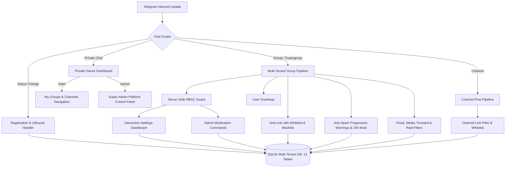

# Waguri – Advanced Multi-Group & Multi-Channel Telegram Management Platform

A high-performance, enterprise-grade Telegram management and moderation platform named **Waguri** (`@Ms_Waguri_bot`) built with Python and `python-telegram-bot` in long polling mode.

Waguri is architected as a **scalable, multi-tenant platform** for unlimited Telegram groups, supergroups, and channels, featuring complete tenant isolation by `chat_id`, role-based access control (RBAC), private owner dashboards, interactive inline settings panels, progressive anti-spam, whitelist-powered anti-link protection, flood control, media filters, anti-forward, anti-bot, emergency raid mode, and SQLite database persistence with 13 dedicated tables and zero-downtime migrations.

---

## Architecture & Tenant Isolation



---

## Permission Levels (Role-Based Access Control)

Waguri enforces 3 distinct, server-side verified permission levels:

1. **Group Owner (`status == OWNER`):**
   - Full control over all moderation features, spam thresholds, punishment durations, warning messages, and group reset.
   - Authority to authorize Waguri group managers and customize protection rules.
2. **Authorized Group Administrators (`status in [ADMINISTRATOR, OWNER]`):**
   - Manage moderation settings via `/settings`, `/enable`, `/disable`.
   - Issue manual moderation penalties: `/mute`, `/unmute`, `/ban`, `/unban`, `/warnings`, `/resetwarnings`.
   - Manage whitelist (`/whitelist`) and blacklist (`/blacklist`).
   - Review moderation audit logs (`/logs`) and live group statistics (`/stats`).
3. **Regular Members:**
   - Strictly forbidden from modifying bot settings, disabling protections, or accessing private audit logs.
   - Any attempt to execute administrative commands is rejected:
     ```text
     You need administrator privileges to use this command.
     ```

---

## Private Owner Dashboard (`/start` in Private)

When someone opens a private chat with `@Ms_Waguri_bot` and sends `/start`, Waguri displays a private dashboard with 8 interactive inline buttons:

```text
👑 Welcome to Waguri Management Platform!

Select an option below to manage your chats or learn more:
[ ➕ Add Waguri to Group ]   [ 📢 Add Waguri to Channel ]
[ 👥 My Groups ]            [ 📢 My Channels ]
[ 📖 Help & Commands ]       [ ℹ️ About Waguri ]
[ 💬 Contact Support ]       [ ⚡ Bot Features ]
```

- **`My Groups` & `My Channels`:** Queries all registered chats and performs server-side verification to display **only** chats where the user holds verified administrative privileges. Selecting any chat displays its live management summary.
- **Group `/start` Preservation:** When `/start` is sent inside a group or channel, Waguri maintains its standard greeting:
  ```text
  Hi, welcome. I am Waguri. How can I help you
  ```

---

## Interactive Group Management Dashboard (`/settings`)

When a verified administrator sends `/settings` in a group, Waguri presents an interactive mobile-optimized inline keyboard:

```text
⚙️ WAGURI GROUP MANAGEMENT
👥 Group: Tech Community
🆔 ID: -1001234567890

Moderation Controls:
[ 🔗 Anti-Link: ON 🟢 ]        [ 🛡️ Anti-Spam: ON 🟢 ]
[ 🌊 Flood: ON 🟢 ]            [ ⚠️ Warnings: ON 🟢 ]
[ ⛔ Auto-Restrict: ON 🟢 ]     [ ⏩ Anti-Forward: OFF 🔴 ]
[ 🚪 Anti-Join Spam: OFF 🔴 ]   [ 🤖 Anti-Bot: OFF 🔴 ]
[ 📸 Media Filter: OFF 🔴 ]    [ 🌐 Link Whitelist ]
[ ⏱ Spam (30s) ]              [ 🔢 Warn Limit (2) ]
[ 📊 Group Statistics ]        [ 📋 Moderation Logs ]
[ 🔄 Refresh ]                 [ ❌ Close ]
```

- **Real-Time Toggles:** Toggles Anti-Link, Anti-Spam, Flood Detection, Warning System, Auto-Restriction, Anti-Forward, Anti-Join Spam, Anti-Bot, and Media Filter.
- **Sub-Menus:**
  - 🌐 **Link Whitelist:** View trusted domains allowed in the group.
  - ⏱ **Spam Window:** Adjust detection window: `15s`, `30s`, `45s`, `60s`, `120s`.
  - 🔢 **Warning Limit:** Adjust warning threshold: `1`, `2`, `3`, `4`, `5`.
  - 📊 **Group Statistics:** View messages checked, links deleted, spam deleted, warnings issued, and restrictions applied.
  - 📋 **Moderation Logs:** Review the latest audit events with timestamps.
  - ❌ **Close:** Closes the dashboard cleanly.
- **Server-Side Verification:** Every callback query re-verifies administrator status before applying changes.

---

## Moderation Systems & Features

### 1. Advanced Anti-Link Protection with Whitelisting
- **Detection Scope:** Standard HTTP/HTTPS URLs, `www.`, bare domains (`example.com`, `site.io`), Telegram links (`t.me/...`), invite links (`t.me/+xxxxx`), deep links (`tg://...`), hidden hyperlinked text (`TEXT_LINK`), and caption links in media.
- **Exemptions:** Group owner and administrators are exempt.
- **Per-Group Link Whitelist:**
  - `/whitelist add <domain>` – Add a trusted domain (e.g. `/whitelist add google.com`).
  - `/whitelist remove <domain>` – Remove a domain.
  - `/whitelist list` – View all whitelisted domains.
  - If all detected URLs in a message match whitelisted domains, the message is permitted.
- **Per-Group Content Blacklist:**
  - `/blacklist add <pattern>` – Block specific domains, phishing phrases, or keywords.
  - `/blacklist remove <pattern>` – Remove from blacklist.
  - `/blacklist list` – View blacklisted patterns.

### 2. Advanced Anti-Spam System
- **Comparison Engine:** Normalized whitespace comparison, trimmed edges, case-insensitivity, and SHA-256 content fingerprinting.
- **Progressive Punishment Sequence:**

| Message Count | Action Taken | Warning Issued |
|---|---|---|
| **1st message** | Allowed | No warning |
| **2nd identical message** | Deleted | ⚠️ **Warning 1/2** |
| **3rd identical message** | Deleted | ⚠️ **Warning 2/2** |
| **4th identical message** | Deleted + Batch Purge | 🚫 **24-Hour Restriction** |

- **Custom Warnings & Cleanup:** Group administrators can customize warning messages via database settings. Temporary warnings auto-delete after 10 seconds to keep chats clean.
- **Batch Spam Cleanup:** On the 4th violation, all recorded prior messages from the spam incident are automatically purged.
- **Reliable 24-Hour Restriction:** Restricts message permissions for 24 hours while allowing reading. Permissions restore cleanly upon expiration.

### 3. Flood & Burst Message Protection
- Tracks message frequency per `(chat_id, user_id)`.
- Default: `FLOOD_WINDOW_SECONDS = 10`, `FLOOD_MESSAGE_LIMIT = 8`.
- Logs alerts and provides group owners configurable burst controls.

### 4. Additional Protection Modules
- **Anti-Forward:** Detects and deletes forwarded channel/group messages from regular members when enabled.
- **Anti-Bot Protection:** Detects unauthorized bots added by regular members, removes them, and alerts group administrators.
- **Anti-Join Spam:** Monitors join bursts (e.g., $\ge 5$ joins in 10s) and alerts administrators.
- **Media Restrictions:** Per-group toggle for photos, videos, documents, stickers, GIFs/animations, voice notes, and video notes.
- **Emergency Raid Mode:** `/raid on` enables high-alert lockdown mode; `/raid off` restores normal moderation.

---

## Interactive Help & Command Launcher (`/help`)

When `/help` is sent in any chat or accessed via `📖 Help & Commands` in the private dashboard, Waguri displays an **interactive, clickable command launcher**:

```text
🤖 Waguri Bot Commands & Help

Tap any command button below to execute it or view its sub-options:

• Direct Commands: Execute immediately and return information.
• Options Commands (▾): Open sub-options to configure or toggle features.

[ ℹ️ /about ]       [ 💬 /contact ]      [ 🆔 /id ]
[ ⚙️ /settings ]    [ ⚡ /features ]     [ 📊 /stats ]      [ 📋 /logs ]
[ 🔗 /antlink ▾ ]   [ 🛡️ /antispam ▾ ]   [ 🚨 /raid ▾ ]
[ ✅ /enable ▾ ]    [ ❌ /disable ▾ ]
[ 🌐 /whitelist ▾ ] [ 🚫 /blacklist ▾ ]
[ 🔇 /mute ▾ ]      [ 🔊 /unmute ]       [ ⚠️ /warnings ]
[ 🔨 /ban ]         [ 🔓 /unban ]        [ 🔄 /resetwarnings ]
[ ❌ Close Help Menu ]
```

### Direct Commands vs Options Commands
1. **Direct Commands (`/about`, `/contact`, `/id`, `/settings`, `/features`, `/stats`, `/logs`, `/unmute`, `/warnings`, `/ban`, `/unban`, `/resetwarnings`):**
   - Tapping immediately executes the command and renders the result with a `[⬅️ Back to Commands]` navigation button.
   - Non-administrators clicking admin commands are rejected by server-side RBAC with an instant notification alert.
2. **Commands with Options (`/antlink ▾`, `/antispam ▾`, `/raid ▾`, `/enable ▾`, `/disable ▾`, `/whitelist ▾`, `/blacklist ▾`, `/mute ▾`):**
   - Tapping opens an interactive sub-options selection card displaying all available arguments/choices.
   - Selecting any option executes that sub-command (e.g. `/antlink on`, `/enable flood`, `/whitelist list`, `/mute 1h`) and confirms with a `[⬅️ Back to Commands]` button.
   - In private chats, clicking group-specific options provides a guided shortcut to the `👥 My Groups` dashboard.

---

## Command Reference

### General User Commands (`BotCommandScopeDefault`)
- `/start` – Open private dashboard (in private) or send group welcome (in groups).
- `/help` – Interactive clickable command launcher and documentation.
- `/about` – Information about Waguri's architecture.
- `/contact` – Directs users to bot administrator `@lucky_paji`.

### Group Management & Moderation (`BotCommandScopeAllChatAdministrators`)
- `/settings` – Open the interactive inline management dashboard.
- `/features` – View statuses of all moderation features for the current chat.
- `/stats` – View isolated moderation statistics for the current chat.
- `/logs` – Review recent moderation audit actions.
- `/id` – Inspect chat ID, sender ID, and replied message/user IDs.
- `/enable <feature>` – Enable a feature (`antilink`, `antispam`, `flood`, `warnings`, `autorestrict`, `antiforward`, `antijoin`, `antibot`, `media`, `raid`).
- `/disable <feature>` – Disable a feature.
- `/whitelist [add|remove|list] <domain>` – Manage link whitelist.
- `/blacklist [add|remove|list] <pattern>` – Manage content blacklist.
- `/warnings [reply|user_id]` – View member warnings and restriction history.
- `/resetwarnings [reply|user_id]` – Clear all warnings for a member.
- `/mute [reply|user_id] [duration]` – Temporarily mute a user (e.g. `/mute 10m`, `/mute 2h`, `/mute 1d`).
- `/unmute [reply|user_id]` – Remove restrictions and unmute member.
- `/ban [reply|user_id]` – Ban a user from the group.
- `/unban <user_id>` – Unban a previously banned user.
- `/raid [on|off]` – Toggle emergency raid lockdown mode.

### Super-Admin Bot Owner Controls
Accessible only to Telegram User IDs configured in `BOT_OWNER_IDS`:
- `/owner` – View platform scale, active chats, uptime, database health, and activity metrics.
- `/owner broadcast <message>` – Send a rate-limited announcement across all registered chats.
- `/owner emergency <feature> [on|off]` – Apply a global emergency feature override without mutating individual group settings.

---

## Multi-Tenant Database Architecture (`moderation.db`)

Waguri utilizes a 13-table SQLite database with Write-Ahead Logging (`WAL` mode) and indexes on `(chat_id)`:

1. **`chats`**: Registered groups and channels with titles, types, active statuses, and timestamps.
2. **`chat_settings`**: Per-chat toggles (`anti_link_enabled`, `anti_spam_enabled`, `flood_detection_enabled`, `warning_system_enabled`, `auto_restrict_enabled`, `anti_forward_enabled`, `anti_join_spam_enabled`, `anti_bot_enabled`, `media_restrictions_enabled`, `allowed_media_types`, `spam_window_seconds`, `warning_limit`, `restriction_duration_seconds`, `raid_mode_enabled`).
3. **`chat_admins`**: Role-based permissions mapping (owner, admin, manager).
4. **`chat_moderation_logs`**: Timestamped audit trail of all moderation actions.
5. **`chat_warnings`**: Progressive warnings issued to users.
6. **`chat_spam_incidents`**: Rolling spam tracking per `(chat_id, user_id)`.
7. **`chat_spam_messages`**: Recorded spam message IDs for batch purge upon restriction.
8. **`chat_link_whitelist`**: Trusted domains per chat.
9. **`chat_blacklist`**: Blocked patterns and domains per chat.
10. **`chat_statistics`**: Live moderation metrics per chat.
11. **`chat_join_events`**: Member join timestamps for anti-join spam and anti-bot.
12. **`user_restrictions`**: Mute and ban history with previous permissions for clean restoration.
13. **`callback_sessions`**: Ephemeral secure callback data storage.

---

## Project Structure

```text
Waguri/
│
├── config.py                 # Configuration, token validator & owner ID parser
├── database.py               # 13-table SQLite multi-tenant schema & migrations
├── bot.py                    # Main application runner & polling manager
│
├── handlers/
│   ├── __init__.py           # Pipeline registration across priority groups 0 to 4
│   ├── registration.py       # Bot join/leave lifecycle tracking (ChatMemberHandler)
│   ├── private_dashboard.py  # Private owner dashboard with 8 inline buttons
│   ├── settings_panel.py     # Interactive /settings dashboard & callback router
│   ├── feature_commands.py   # /features, /enable, /disable, /stats
│   ├── admin_check.py        # RBAC verification, permission check & admin TTL cache
│   ├── admin_commands.py     # /antlink, /antispam, /mute, /unmute, /ban, /unban, /warnings, /logs, /id
│   ├── anti_link.py          # Anti-link filter, whitelist & blacklist (/whitelist, /blacklist)
│   ├── anti_spam.py          # Progressive anti-spam, 24h restrictions & batch cleanup
│   ├── media_protection.py   # Media filters (photos, videos, documents, stickers, voice)
│   ├── extra_protection.py   # Anti-forward, anti-bot, anti-join spam, /raid command
│   ├── bot_owner.py          # Super-admin dashboard (/owner, broadcast, emergency)
│   ├── commands.py           # Commands (/start, /help, /about, /contact)
│   ├── command_menu.py       # BotCommandMenu setup for Default & Admin scopes
│   ├── greetings.py          # Greetings ("hii", "hlw", "hello")
│   └── error_handler.py      # Global exception logger
│
├── scratch/
│   ├── test_platform_full.py        # Automated platform test suite (9 test cases)
│   ├── test_multi_group_channel.py  # Multi-group & channel isolation tests (7 test cases)
│   └── test_full_regression.py      # Regression tests (6 test cases)
│
├── .env                      # Bot credentials & super-owner IDs (git-ignored)
├── .env.example              # Environment template
├── .gitignore                # Protects secrets, databases, and caches
├── requirements.txt          # Python dependencies
└── README.md                 # Complete documentation
```

---

## Installation & Setup

1. **Install dependencies:**
   ```bash
   pip install -r requirements.txt
   ```

2. **Configure `.env`:**
   ```env
   TELEGRAM_BOT_TOKEN=8840030276:AAE0dSMNopthg8_awRfMV3gSG9CZqdbJtUM
   BOT_OWNER_IDS=your_telegram_user_id
   ```

3. **Run the bot:**
   ```powershell
   python bot.py
   ```

4. **Execute all test suites:**
   ```powershell
   python scratch/test_platform_full.py
   python scratch/test_multi_group_channel.py
   python scratch/test_full_regression.py
   ```

> [!IMPORTANT]
> **Telegram BotFather Settings:**
> 1. Message [@BotFather](https://t.me/BotFather) on Telegram.
> 2. Send `/setprivacy` $\rightarrow$ select `@Ms_Waguri_bot` $\rightarrow$ choose **Disable** (enables message monitoring in groups).
> 3. Waguri must be granted **Delete Messages** and **Ban Users / Restrict Members** administrator permissions in groups.
