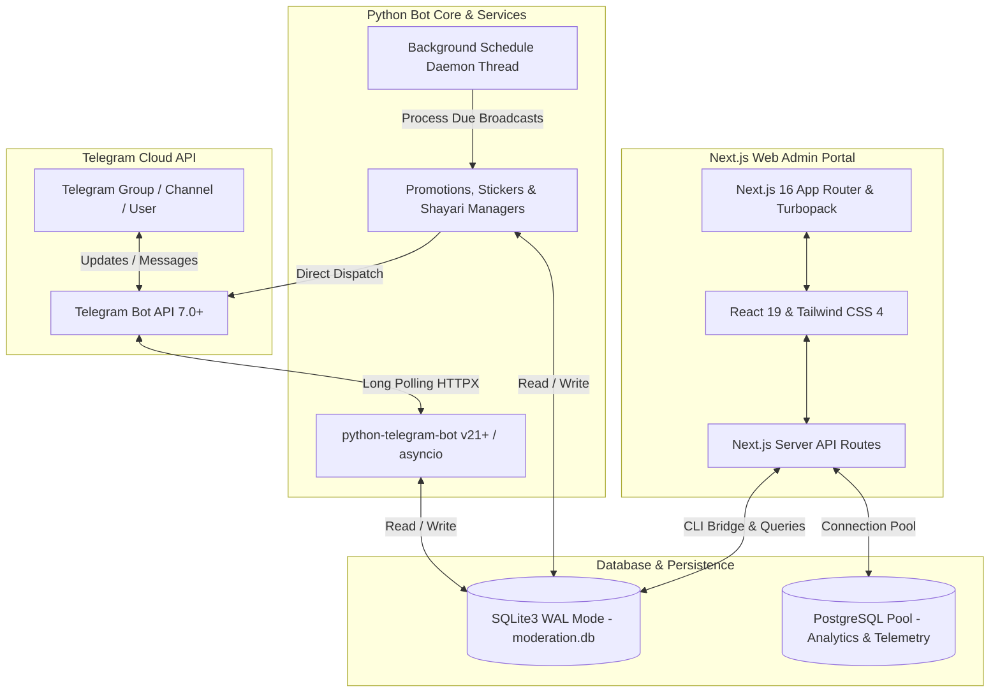
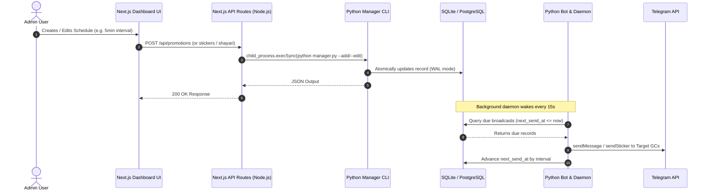

# Waguri Bot – Technology Stack & Architecture (TECH.md)

This document provides a comprehensive overview of all technologies, frameworks, libraries, protocols, database systems, and architectural patterns utilized in the development and operation of the **Waguri Telegram Management Bot** and its accompanying **Web Administration Dashboard**.

---

## 1. High-Level Architecture Overview

The system is built as a dual-layer, high-performance platform:
1. **Bot Engine Layer (Python)**: An asynchronous, event-driven Telegram bot handling high-throughput real-time message moderation, automated scheduling, business secretary auto-replies, and community management.
2. **Dashboard Layer (Next.js & TypeScript)**: A modern, real-time web administration portal providing complete administrative controls over scheduled promotions, stickers, shayari broadcasts, group settings, analytics, and user telemetry.

---

## 2. Core Programming Languages & Runtimes

| Technology | Version / Specification | Role in System |
| :--- | :--- | :--- |
| **Python** | `3.10+` / `3.11` / `3.12` | Powers the core Telegram bot, handler pipelines, moderation filters, daemon scheduler, and CLI data managers. |
| **Node.js** | `18+` / `20+` (LTS) | JavaScript runtime hosting the Next.js server, API routing, and build environment. |
| **TypeScript** | `^5.0.0` | Provides strict static type safety across the entire administrative frontend, UI state, and API payload definitions. |

---

## 3. Telegram Bot Engine & Ecosystem

| Component | Library / Protocol | Purpose & Implementation Details |
| :--- | :--- | :--- |
| **Bot Framework** | `python-telegram-bot` (`>=21.0`) | Fully asynchronous Telegram bot library utilizing Python `asyncio`. Manages `ApplicationBuilder`, update routers, command handlers, and error boundaries. |
| **Telegram Bot API** | API `7.0+` | Implements group moderation (`banChatMember`, `restrictChatMember`, `deleteMessage`), message delivery (`sendMessage`, `sendSticker`), and interactive UI (`InlineKeyboardMarkup`, `InlineKeyboardButton`). |
| **HTTP Transport** | `HTTPX` via `HTTPXRequest` | High-performance asynchronous HTTP client handling Telegram connection pooling, proxy integration (`TELEGRAM_PROXY_URL`), configurable read/write timeouts, and exponential backoff retry policies. |
| **Telegram Business API** | Telegram Business Secretary Mode | Allows users to connect personal business accounts, automatically responding to first-time incoming private chats with duplicate-safe tracking. |
| **Concurrency Model** | Python `asyncio` + `threading.Thread` | Non-blocking asynchronous event loop for Telegram updates combined with a background thread daemon waking every 15s to evaluate recurring broadcast schedules. |

---

## 4. Frontend Web Administration Dashboard

| Layer | Technology | Details |
| :--- | :--- | :--- |
| **Framework** | **Next.js 16.4.6** | Modern React full-stack framework utilizing the **App Router** (`src/app/`) for unified server-side rendering, client interactive pages, and backend API routes. |
| **UI Library** | **React 19.3.0** & **React DOM 19.3.0** | Component-driven declarative UI utilizing modern hooks (`useState`, `useEffect`, `useMemo`, `useCallback`, `useRef`). |
| **Styling Engine** | **Tailwind CSS 4.3.3** | High-performance utility-first styling with dark-mode color palettes, translucent glassmorphism panels, responsive layout grids, and modern UI transitions. |
| **Bundler & Build Tool** | **Turbopack** (`@tailwindcss/turbopack`) | High-speed, Rust-powered bundler providing instantaneous Hot Module Replacement (HMR) and optimized production builds. |
| **Iconography** | **Lucide React** (`^1.73.0`) | Clean, accessible vector icons for admin menus, status indicators, schedule clocks, modal buttons, and analytics cards. |

---

## 5. Database Systems & Data Persistence

### A. Primary Relational Storage (SQLite 3)
- **Engine**: SQLite 3 via Python built-in `sqlite3` module.
- **Concurrency & Reliability**:
  - `PRAGMA journal_mode = WAL` (Write-Ahead Logging) allows concurrent read access while writing, preventing lockups between the bot and frontend.
  - `PRAGMA foreign_keys = ON` guarantees referential integrity.
  - `conn.row_factory = sqlite3.Row` for dictionary-style column access.
- **Schema & Tables (18+ Tables)**:
  - `chats`: Group chat metadata, active status, join timestamps, and registration info.
  - `group_settings`: Granular per-group protection toggles (anti-link, anti-spam, raid mode, service clean, etc.).
  - `whitelist_domains` & `blacklist_domains`: Per-group domain rules.
  - `spam_records`: User message timestamps, frequency counters, and penalty levels.
  - `warning_records`: Active user warnings and threshold limits.
  - `moderation_logs`: Detailed audit trail of moderator and automated bot actions.
  - `raid_state`: Real-time tracking of join floods and lockdown triggers.
  - `greetings`: Custom welcome messages and media configuration per group.
  - `personal_secretary`: Telegram Business auto-reply profiles and recipient logs.
  - `promotions`: Scheduled promotional text broadcasts, buttons, intervals, and target GCs.
  - `stickers`: Scheduled sticker delivery tasks, file IDs, target types, and recurrence.
  - `scheduled_shayari`: Creative poetry broadcast scheduler, target selection, and recurrence intervals.
  - `shayari_vault`: Curated repository of shayari messages categorized by theme.
  - `shayari_send_logs`: Historical logs of broadcast dispatches.

### B. Enterprise Analytics & Telemetry Storage (PostgreSQL)
- **Libraries**: `pg` (`^8.23.1`) for Node.js and `psycopg2-binary` (`>=2.9.0`) for Python.
- **Connection Management**: Configured via `pg.Pool` with connection timeout limits and auto-detecting SSL rules (`rejectUnauthorized: false`) supporting Neon, Supabase, AWS RDS, and self-hosted PostgreSQL instances.
- **Tables**: `daily_stats`, `daily_stats_history`, `telemetry_events`.

---

## 6. Background Scheduling & Dispatch Engine

| Capability | Technical Mechanism |
| :--- | :--- |
| **Worker Execution** | Dedicated daemon scheduler ([scheduler_daemon.py](file:///c:/Users/Suraj/Desktop/New%20folder/bot/scheduler_daemon.py)) and background worker thread in [bot.py](file:///c:/Users/Suraj/Desktop/New%20folder/bot/bot.py) checking due broadcasts with 5-second precision. |
| **Interval Parser & Strict Time Gap** | Strict seconds-level precision (`parse_dt`, `interval_delta`) supporting exact gaps: `3min`, `5min`, `10min`, `15min`, `30min`, `1 hr`, `2h`, `4h`, `6h`, `12h`, `daily`, `weekly`. Automatically prevents early or duplicate firings using dynamic cooldown checks. |
| **Dynamic Sticker Pack Rotation** | Connects to Telegram `getStickerSet` to query all stickers in a set; cycles sequentially (`(index + 1) % total`) so every interval sends a different sticker from the pack. |
| **Time Drift Protection** | Computes `compute_next_datetime()` advancing in a `while next_dt <= now` loop to prevent back-to-back duplicate firings if the bot was offline. |
| **Chat Routing** | Evaluates `target_type`: targets a `single` chat, `selected` list of chats, or dynamically queries active groups with `all_gc`. |
| **Frontend Isolation** | All scheduling configurations, edits, and intervals are managed **exclusively through the Next.js web frontend** with zero commands or keyboards exposed in Telegram chats. |

---

## 7. Security, Moderation & Moderation Algorithms

| Protection Feature | Mechanism & Algorithm |
| :--- | :--- |
| **Role-Based Access Control (RBAC)** | Dynamic privilege validation querying Telegram chat member status (`is_sender_admin_or_owner`, `is_bot_owner`, `is_group_owner`). |
| **Anti-Spam & Flood Control** | Token-bucket sliding window frequency counter; message fingerprinting via normalized SHA-256 / hash comparisons to detect copy-paste floods. |
| **Anti-Link Filtering** | Regex pattern matching for standard URLs, Telegram invite links (`t.me/+`, `telegram.me`), and usernames against per-group domain whitelists and blacklists. |
| **Service Message Cleaner** | Automatic detection and deletion of system service messages (`new_chat_members`, `left_chat_member`, `pinned_message`). |
| **Emergency Raid Mode** | Automated rate-limiting of join events within rolling time windows; temporary mass-restricting of incoming accounts during bot raids. |

---

## 8. Inter-Process Communication & Architecture Bridge

- **API Route Handlers**: Next.js route handlers in `frontend/src/app/api/` execute Python management scripts safely via Node's `child_process` (`execSync` / `spawn`), formatting and returning typed JSON.
- **Cross-Platform Compatibility**: Fully compatible with both Windows (PowerShell/CMD) and Linux (Bash/Docker/systemd).

---

## 9. Development, Quality Assurance & Tooling

- **Version Control**: Git for distributed branch management and atomic commits.
- **Linting & Code Quality**:
  - `eslint` (v9) with `eslint-config-next` for frontend JavaScript/TypeScript validation.
  - Flake8 / PEP 8 standards for Python codebase.
- **Environment Management**:
  - `python-dotenv` for loading sensitive environment variables (`BOT_TOKEN`, `BOT_OWNER_IDS`, `DATABASE_PATH`).
  - Next.js environment resolution (`process.env.POSTGRES_URL`, `process.env.DATABASE_URL`).
- **Static Analysis**: TypeScript Compiler (`tsc --noEmit`) integrated into build verification pipeline.

---

## 10. Summary Table

| Category | Primary Technologies Used |
| :--- | :--- |
| **Backend & Bot Core** | Python 3.10+, `python-telegram-bot` 21+, `HTTPX`, `asyncio`, `threading` |
| **Frontend Framework** | Next.js 16.4 (App Router), React 19.3, TypeScript 5 |
| **Styling & Assets** | Tailwind CSS 4.3, Turbopack, Lucide React Icons |
| **Databases** | SQLite 3 (WAL mode), PostgreSQL (`pg`, `psycopg2-binary`) |
| **Communication Protocols** | Telegram Bot API 7.0 (Long Polling, HTTP/2, REST), JSON IPC |
| **Security & Access** | Role-Based Access Control (RBAC), Regex Domain Filters, Message Fingerprinting |
| **Configuration** | `python-dotenv`, `.env`, Next.js runtime environment variables |
